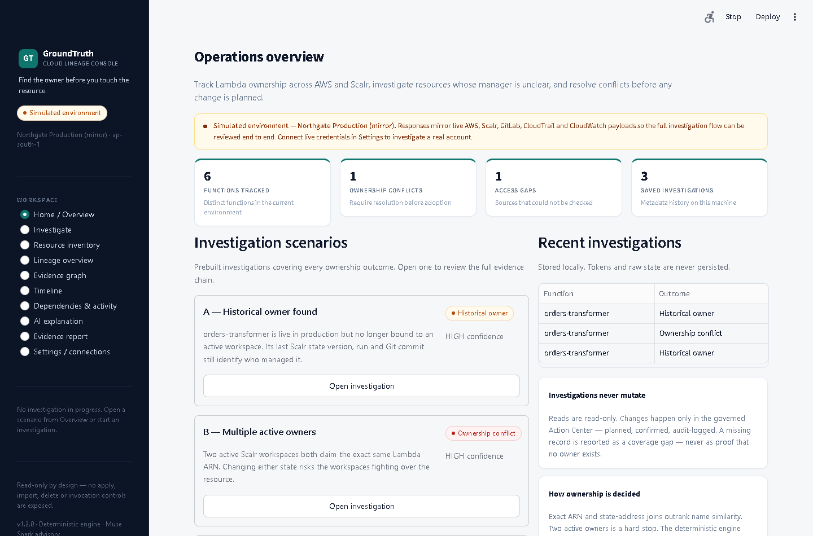
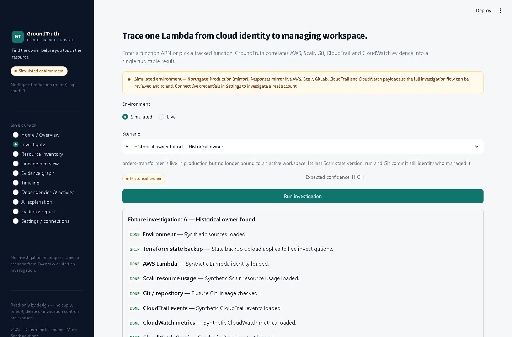
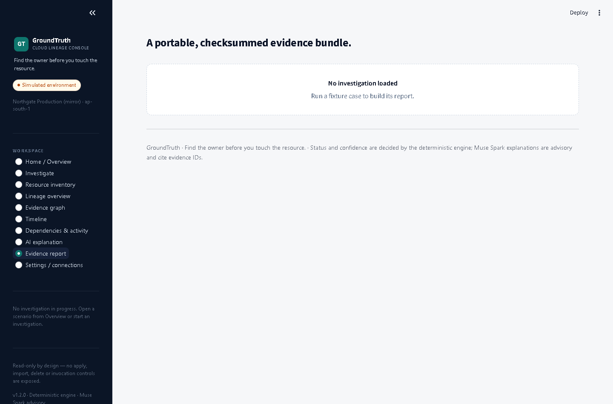
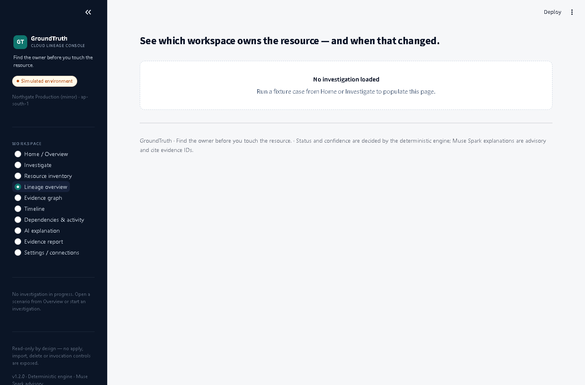
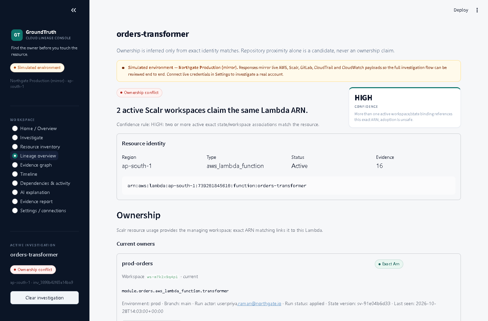

# GroundTruth

[](https://github.com/EricMaxwellnetizen/GroundTruthAI/actions/workflows/ci.yml)

**Find the owner before you touch the resource.**

GroundTruth is a local-first, read-only AWS resource lineage investigator. Give it a Lambda ARN or function name and it correlates AWS identity, Scalr resource usage, Terraform workspace history, VCS commits, local Git evidence, CloudTrail management events, and CloudWatch activity into one auditable investigation.

The deterministic engine owns the status and confidence. Meta Muse Spark can explain the evidence in plain English, but it cannot invent an owner, change a status, or authorize a change. When evidence is missing, GroundTruth shows the coverage gap instead of guessing.



> ### For judges — evaluate in 3 minutes
> **Stage 1 (theme + Meta AI):** Built for the Meta Global AI Developer Hackathon around **Meta Muse Spark (`muse-spark-1.3`, Meta Model API — live-verified, see `docs/DELIVERY_REPORT.md`)** with a bounded, read-only **tool-calling loop**: the model requests evidence tools, every factual claim must cite a validated evidence ID, and invalid output falls back deterministically. Prefer open weights? Switch Settings → AI provider to **Llama** on any OpenAI-compatible endpoint — identical grounding guarantees. No chatbot wrapper: the model explains, deterministic code decides.
> **Click path (offline-safe, ~3 min):** `streamlit run app.py` → **Open investigation: A — Historical owner found** → **Lineage overview** (owner, run, commit, adoption preview, Action Center) → **Evidence graph** → **AI explanation** (cited facts; regenerate live if a key is set) → **Evidence report** (download the checksummed bundle) → back on **Overview**, run the **automation sweep**. Then try **B — Multiple active owners** for the hard stop. Full narration: [`docs/DEMO.md`](docs/DEMO.md).
>
> | Rubric lens | Where to verify | Evidence |
> | --- | --- | --- |
> | Meta AI depth | AI explanation page; `groundtruth/ai/` | Tool loop with budgets/allowlist, citation validation, fallback; Llama option |
> | Innovation | Lineage engine; scenario B/G | Exact-identity ownership graph, duplicate hard stop, cross-account guardrail — not another inventory/chatbot |
> | Impact | Overview "Needs attention"; Action Center | Prevents duplicate-state outages; governed reattribute/retire with audit log |
> | Technical quality | `python -m pytest -q` (140+ tests) | Deterministic statuses, checksummed exports, redaction, Docker, CI |
> | Completeness | All 10 pages; 8 scenarios | Every terminal status covered; live mode from UI credentials; works with AI off |

> **Simulated environment (default).** The console opens against the Northgate Production mirror — payloads shaped like live AWS, Scalr, GitLab, CloudTrail and CloudWatch responses (real-format ARNs, workspace/run IDs, commit SHAs, principal ARNs). No live account is queried until live mode is configured and its connection test succeeds.

## The problem

A Lambda is running in production, but nobody can find it in the expected Terraform repository or Scalr workspace. The evidence is split across AWS, state history, run records, Git, CloudTrail, and CloudWatch. Guessing is dangerous; deleting the wrong resource is worse.

GroundTruth answers one narrow, high-value question:

> **What evidence exists for this resource's ownership, and where exactly does that evidence end?**

## Go live in 60 seconds (no file editing)

Open **Settings / connections → Connect live environment**, paste your AWS profile/region, Scalr URL + read-only token + resource-usage filter, Git path, and your AI key — then **Save credentials & switch**. GroundTruth writes `.env` for you, keeps a gitignored backup in `.groundtruth/credentials.backup.env`, and never displays secrets back. Prefer files? `.env.example` still works.

**Choose your model:** hosted **Meta Muse Spark**, or **Llama open weights** on any OpenAI-compatible endpoint you control (your cloud, your VPC, local vLLM/Ollama) — same grounded explanations, same citation validation, same deterministic status either way.

**Act, don't just observe:** the Lineage **Action Center** plans reattribution or retirement for any function, blocks unsafe actions (managed, contested, unchecked), requires typed confirmation, and audit-logs every outcome. The Overview **automation sweep** prepares reattributions for everything that needs attention; disputes and deletions always wait for a human. Connector-doc freshness is checked on a schedule and drafts an AI review brief — deterministic code only changes through reviewed commits.

## What ships in this release

- **Simulated environment** with eight known-answer scenarios covering every terminal status, plus a deterministic adoption-proposal preview (import blocks, never applied).
- **Read-only live connectors** for AWS Lambda, IAM role metadata, CloudTrail, CloudWatch metrics, Scalr, local Git, optional GitLab, and optional CloudWatch Omni context.
- **Deterministic ownership engine** with exact-identity match tiers and seven terminal statuses.
- **Muse Spark explanation** with a guarded, bounded read-only tool loop, strict citation validation, and a deterministic fallback.
- **Optional local Terraform state backup** parsed in memory as user-supplied historical evidence; raw state is never persisted or sent to the model.
- **Ten-page Streamlit workspace**: overview, investigation, inventory, lineage, evidence graph, timeline, dependencies, AI explanation, report, and settings.
- **Checksummed exports** in JSON and Markdown, with account IDs redacted by default.
- **SQLite metadata history** for completed investigations.
- **Read-only MCP adapter** with a default-deny allowlist.

### Screenshots

| Investigation progress | Evidence report |
| --- | --- |
|  |  |

| Historical lineage | Duplicate-owner hard stop |
| --- | --- |
|  |  |

## Quickstart

### Windows PowerShell

```powershell
python -m venv .venv
.venv\Scripts\Activate.ps1
python -m pip install --upgrade pip
pip install -r requirements.txt
copy .env.example .env
streamlit run app.py
```

### macOS / Linux

```bash
python -m venv .venv
source .venv/bin/activate
python -m pip install --upgrade pip
pip install -r requirements.txt
cp .env.example .env
streamlit run app.py
```

Open `http://localhost:8501`. On the Overview page, click **Open investigation** on any scenario. Case A (`Historical owner found`) is the recommended starting point.

No credentials are required for the simulated environment. The mirrored Git repository is generated under `demo-data/data-pipelines`; scenario payloads live in `fixtures/cases/`.

## Simulated scenarios (Northgate Production mirror)

Account `739201845610`, Scalr host `northgate.scalr.io`, repositories under `gitlab.com/northgate/*`. All identifiers use production formats; the tenant itself is simulated.

| Case | Scenario | Expected status | Confidence |
| --- | --- | --- | --- |
| `A_historical_owner` | Active binding is gone; historical state and Git still identify a manager | `HISTORICAL_OWNER_FOUND` | HIGH |
| `B_multiple_active_owners` | Two active Scalr records claim the exact same Lambda identity | `MULTIPLE_ACTIVE_OWNERS` | HIGH |
| `C_candidate_lineage` | Similar name/path only; no exact identity relationship | `CANDIDATE_LINEAGE` | LOW |
| `D_insufficient_access` | Required Scalr and CloudTrail reads are denied or unavailable | `INSUFFICIENT_ACCESS` | UNKNOWN |
| `E_current_owner` | One active exact Scalr resource-usage binding | `CURRENT_OWNER_FOUND` | HIGH |
| `F_unattributed` | Live and invoked, but no checked source claims the function | `UNATTRIBUTED_IN_CHECKED_SOURCES` | UNKNOWN |
| `G_identity_ambiguous` | Exact ARN present but recorded under a different AWS account | `IDENTITY_AMBIGUOUS` | UNKNOWN |
| `H_current_owner_fraud` | Second region/team (`eu-west-1`, risk platform) with one active owner | `CURRENT_OWNER_FOUND` | HIGH |

The engine can also return `UNATTRIBUTED_IN_CHECKED_SOURCES` and `IDENTITY_AMBIGUOUS` for live evidence that does not fit a known-answer fixture.

## The trust model

Status is selected by deterministic code, never by the language model:

1. Exact ARN plus exact account/region identity can support an ownership claim.
2. Provider ID and address matches require matching AWS account and region guardrails.
3. Weak name or tag matches never override an exact match.
4. Multiple active exact owners produce a hard stop.
5. Historical exact ownership is not current ownership.
6. Missing permissions or incomplete pagination produce a coverage gap, not an empty result.

The AI explanation is advisory. It must cite known evidence IDs and use the deterministic status. A bounded tool loop lets the model request only read-only facts already held in the current investigation result; call count, turns, repeated calls, and timeout are capped. Invalid or unavailable AI output falls back to a grounded deterministic explanation.

## Optional Terraform state backup

The Investigate page can parse a user-supplied `.tfstate` or state JSON file locally. GroundTruth keeps only Lambda identity and non-secret configuration fields, strips outputs, variables, environment values, sensitive attributes, and raw state, and never persists the upload. The result is labelled `user_supplied` and can support a `CANDIDATE_LINEAGE`; it can never override exact live evidence or turn an access gap into an owner.

## Statuses and confidence

Statuses: `CURRENT_OWNER_FOUND`, `HISTORICAL_OWNER_FOUND`, `MULTIPLE_ACTIVE_OWNERS`, `CANDIDATE_LINEAGE`, `UNATTRIBUTED_IN_CHECKED_SOURCES`, `INSUFFICIENT_ACCESS`, `IDENTITY_AMBIGUOUS`.

Confidence labels: `HIGH`, `MEDIUM`, `LOW`, `UNKNOWN`.

## Live configuration

Copy `.env.example` to `.env` and set only the sources you want to use. A source is never displayed as connected until its connection test succeeds.

```dotenv
GROUNDTRUTH_MODE=live
AWS_PROFILE=your-sso-profile
AWS_REGION=ap-south-1
SCALR_BASE_URL=https://your-account.scalr.io
SCALR_API_TOKEN=read-only-token
SCALR_TF_RESOURCE_USAGE_FILTER=your-schema-derived-filter
```

The Scalr filter value is deliberately **not hardcoded**. Obtain the required `filter[tf-resource-usage]` expression from your Scalr API/OpenAPI schema and set it in the environment. The connector fails with an actionable message when it is missing.

- AWS IAM: attach the least-privilege read-only policy in [`policies/aws-read-only-policy.json`](policies/aws-read-only-policy.json). Prefer IAM Identity Center/SSO or an assumed role.
- Scalr: use a read-only API token. GroundTruth never calls apply, approve, import, or state-mutation endpoints.
- Git: set `GIT_REPO_PATH` to a trusted local clone. GitLab REST is optional and only used when project ID/token are configured.
- Meta: set `MODEL_API_KEY`, `META_API_BASE_URL`, `META_MODEL`, and `AI_ENABLED=true`. AI is optional.
- Omni: optional link/context only unless a documented connector is verified.

> **Observed live results (4 November 2026).** Meta Muse Spark returned a valid explanation for Case A (`muse-spark-1.3`, 1 tool call, deterministic status unchanged). A read-only Scalr `/workspaces` call succeeded with 0 workspaces returned. AWS STS returned `InvalidClientTokenId`, so AWS resource-level verification is blocked until valid credentials are supplied. `SCALR_TF_RESOURCE_USAGE_FILTER`, `GIT_REPO_PATH`, GitLab, and MCP remain unset, so those joins are fixture-only or blocked. A configured value is never treated as a successful connection test.

## Quality checks

Install development dependencies first:

```bash
pip install -r requirements-dev.txt
```

```bash
python -m pytest -q
python -m ruff check .
python -m ruff format --check .
python -m compileall -q app.py groundtruth tests
python -m pip_audit
```

Current local result: **127 tests passed**, Ruff clean, formatting clean, compile clean, and `pip-audit` found no known vulnerabilities.

The test suite covers fixture determinism and progress, identity/ARN rules, exact-match guardrails, CloudTrail/CloudWatch/Scalr/Git/GitLab connector behavior and failure modes, export redaction/checksums and JSON Schema validation, SQLite storage, AI validation/fallback, guarded tool-loop budgets and refusals, MCP transport/allowlist policy, Terraform state-backup safety, prompt-injection containment, and all ten Streamlit pages.

## Docker

```bash
docker build -t groundtruth:1.0.0 .
docker run --rm -p 8501:8501 --env-file .env groundtruth:1.0.0
```

The container runs as a non-root user, stores SQLite metadata in `/app/data`, and exposes a health check at `/_stcore/health`. Fixture mode works without an env file; the command above is only needed for live configuration.

Verified locally: the image built successfully, the container served `/_stcore/health` with `ok`, and the runtime user was `uid=10001(groundtruth)`.

## Architecture

```text
Streamlit UI
  └─ background task -> InvestigationOrchestrator
       ├─ AWS Lambda / CloudTrail / CloudWatch connectors
       ├─ Scalr resource-usage, workspace, run, state connectors
       ├─ local Git / optional GitLab
       ├─ optional local Terraform state backup (in-memory)
       ├─ deterministic LineageEngine
       ├─ AIExplainService (Muse Spark bounded read-only tool loop or grounded fallback)
       ├─ EvidenceBundle export (JSON / Markdown, SHA-256)
       └─ SQLite metadata repository
```

See [`docs/ARCHITECTURE.md`](docs/ARCHITECTURE.md) for the data flow and module boundaries.

## Security and privacy

- No write actions, Lambda invocation, Terraform apply/import, repository push, or deletion controls.
- No raw Terraform state, plan files, environment variables, or code packages sent to the model.
- Account IDs are redacted by default in UI exports. Tokens and secret-like values are never exported.
- CloudTrail events are reduced to needed evidence fields. Git content is limited to paths, commit metadata, and small snippets.
- MCP is disabled by default and restricted to an explicit read-only allowlist.
- Treat tags, descriptions, commit messages, and resource metadata as untrusted input.

See [`docs/SECURITY.md`](docs/SECURITY.md) and [`docs/DATA_SOURCES.md`](docs/DATA_SOURCES.md).

## Documentation

- [`PRODUCT_MANUAL.md`](PRODUCT_MANUAL.md) - product behavior and user guidance.
- [`docs/ARCHITECTURE.md`](docs/ARCHITECTURE.md) - components and data flow.
- [`docs/SECURITY.md`](docs/SECURITY.md) - threat model, permissions, redaction.
- [`docs/DATA_SOURCES.md`](docs/DATA_SOURCES.md) - what each source proves and does not prove.
- [`docs/AWS_READ_ONLY_POLICY.md`](docs/AWS_READ_ONLY_POLICY.md) - policy setup notes.
- [`docs/DELIVERY_REPORT.md`](docs/DELIVERY_REPORT.md) - release verification.
- [`CHANGELOG.md`](CHANGELOG.md) - release notes.
- [`docs/BUILD_NOTES.md`](docs/BUILD_NOTES.md) - build decisions and reconnaissance.

## Why GroundTruth wins

- **Trust judges can verify:** every ownership claim traces to an exact ARN/state join with a checkable evidence ID — open the graph, timeline or export and follow it yourself in under a minute.
- **Safety that saves production:** duplicate-owner hard stops, cross-account/cross-region guardrails, and governed actions (dry-run, typed confirmation, audit log) mean the tool prevents the expensive mistake instead of causing it.
- **Meta AI used correctly:** Muse Spark (or an open-weights Llama endpoint you control) explains deterministic evidence with validated citations; the model never invents an owner, changes a status, or authorizes a change.
- **Works before credentials exist:** the Northgate mirror exercises the identical code paths as live mode, so the full workflow — investigate, explain, propose adoption, export — is reviewable immediately, then goes live from Settings without editing files.
- **Production habits throughout:** 130+ tests, checksummed exports, secret redaction, least-privilege policies, Docker, CI, and background investigations with honest stage progress.

## Scope & guarantees

GroundTruth correlates the sources you connect — AWS Lambda/IAM/CloudTrail/CloudWatch, Scalr workspaces/runs/state, Git/GitLab history — and reports exactly what each source proves. Retention windows (for example CloudTrail Event History) are surfaced as coverage, never hidden. Actions are preview-first and approval-gated; automation only executes under an explicit policy you enable.

## Credits

Built for the Meta Global AI Developer Hackathon. GroundTruth uses Meta Muse Spark through the Meta Model API, AWS read-only APIs, Scalr read APIs, and local Git. Built with Streamlit, Pydantic, boto3, NetworkX, Plotly, pandas, and the OpenAI Python SDK. The product framing is preserved in [`PRODUCT_MANUAL.md`](PRODUCT_MANUAL.md).

## License

> Copyright (c) 2026 Simon Anandan.
>
> This repository's original code is made available under the PolyForm Noncommercial License 1.0.0.
> See the LICENSE file for the complete license terms.
>
> Commercial use requires separate permission from the applicable copyright holder(s).
> Third-party dependencies, integrations, names, and trademarks remain subject to their respective owners' terms and licenses.
