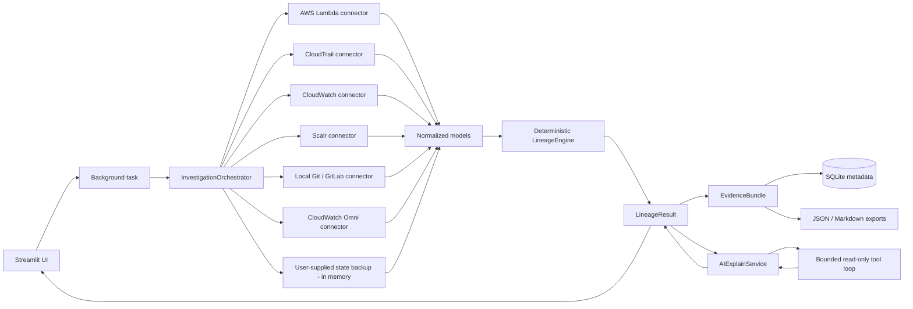

# Architecture

GroundTruth is a local-first Streamlit application with a service layer that is independent of the UI. The deterministic engine is the trust boundary; connectors only supply normalized evidence.

## Data flow



## Runtime modes

- **Fixture mode** (`GROUNDTRUTH_MODE=fixture`) loads `fixtures/cases/*.json`, generates or reads the synthetic demo repository, emits real stage progress, and runs the same engine and export path as live mode. It works without credentials or network access.
- **Live mode** (`GROUNDTRUTH_MODE=live`) calls read-only connectors. Required and optional source failures become `ConnectorResult` statuses such as `permission_denied`, `not_configured`, `rate_limited`, or `partial`; they are never silently converted into empty results.
- **State backup upload** is a live-mode supplement. A `.tfstate`/JSON file is parsed in memory, reduced to non-secret Lambda identity/configuration, and never persisted raw. It cannot override exact live evidence.

## Module map

| Path | Responsibility |
| --- | --- |
| `app.py` | Streamlit entrypoint wrapper for `streamlit run app.py`. |
| `groundtruth/app.py` | Page configuration, sidebar, navigation, flash messages, page dispatch. |
| `groundtruth/config.py` | Environment-backed frozen `Settings`, URL safety checks, defaults. |
| `groundtruth/models/` | Pydantic models for resources, evidence, coverage, connectors, lineage, and report bundles. |
| `groundtruth/connectors/` | Read-only source adapters and shared connector result helpers. |
| `groundtruth/services/orchestrator.py` | Fixture/live coordination, source selection, progress callbacks, partial results. |
| `groundtruth/services/identity.py` | ARN/name/account/region normalization and exact identity helpers. |
| `groundtruth/services/evidence_factory.py` | Stable evidence construction and provenance metadata. |
| `groundtruth/services/lineage_engine.py` | Match hierarchy, status/confidence rules, graph, timeline, dependencies, coverage gaps. |
| `groundtruth/services/state_backup.py` | 8 MB-capped in-memory Terraform state parser; exact-conflict rules; sensitive-field stripping. |
| `groundtruth/ai/` | Muse Spark client, prompt construction, strict validation, deterministic fallback. |
| `groundtruth/ai/tool_loop.py` | Bounded multi-turn tool loop with call/turn/timeout budgets and repeated-call abort. |
| `groundtruth/ai/tools.py` | Read-only internal tool registry and MCP wrapper; rechecks allowlist before execution. |
| `groundtruth/ai/tool_schema.py` | Fail-closed JSON Schema subset validation for tool arguments. |
| `groundtruth/exports/` | Redaction, checksummed JSON export, Markdown report rendering. |
| `groundtruth/storage/` | SQLite metadata repository and secret-like key rejection. |
| `groundtruth/mcp/` | Default-deny MCP registry, client, and policy manager. |
| `groundtruth/ui/components.py` | Shared styling, pills, cards, metrics, evidence chips. |
| `groundtruth/ui/state.py` | Cached services and session result/bundle state. |
| `groundtruth/ui/tasks.py` | Background fixture/live workers and fragment-based task progress. |
| `groundtruth/ui/pages/` | Ten page renderers. |
| `fixtures/cases/` | Synthetic known-answer cases. |
| `demo-data/data-pipelines/` | Synthetic local Git repository used by fixtures. |
| `tests/` | Unit, integration-style, and Streamlit AppTest coverage. |

## Investigation lifecycle

1. The user selects a fixture case or enters a Lambda ARN/name, region, account, time window, and source toggles. In live mode, the user may also upload a Terraform state backup for local parsing.
2. `groundtruth/ui/tasks.py` creates a task and runs the orchestrator in a daemon thread so the UI remains responsive.
3. The orchestrator emits stage events for the fixture loader, state backup, AWS, Scalr, Git, CloudTrail, CloudWatch, Omni, correlation, AI, and export. Optional skipped sources are labeled `skipped`; the UI does not overwrite that with an error.
4. Connectors return `ConnectorResult` values. Pagination caps, permission failures, malformed records, and missing configuration are represented explicitly.
5. `LineageEngine` normalizes identity, creates evidence records, evaluates match tiers, applies status/confidence rules, and builds the evidence graph, timeline, dependencies, recommendations, and unresolved questions. User-supplied state evidence is candidate-only unless an exact live match exists.
6. `AIExplainService` builds a bounded prompt from normalized evidence. When enabled, it runs a guarded multi-turn loop exposing only read-only tools over the already-computed result; call count, turn count, repeated calls, argument schema, and timeout are enforced. The response is validated and any failure falls back to a deterministic explanation. AI cannot change status, confidence, evidence, recommendations, or actions.
7. `build_evidence_bundle` redacts sensitive fields and attaches a SHA-256 checksum over the payload excluding the integrity block.
8. The bundle is saved as metadata in SQLite and rendered by the report page. JSON and Markdown downloads share the same bundle.
9. The Streamlit fragment adopts the completed result, reruns the app, and displays the investigation pages.

## Match hierarchy

The engine evaluates exact identity first and falls back only through defined lower tiers:

```text
exact_arn
exact_provider_id / exact_address (guarded by account + region)
workspace_relation
exact_commit_sha / exact_event_resource
exact_name_context
candidate_name
inferred_dependency
manual_attachment
```

Weak name/tag evidence cannot override an exact match. Multiple active exact owners produce `MULTIPLE_ACTIVE_OWNERS` and block adoption. Historical exact evidence produces `HISTORICAL_OWNER_FOUND`, not a current ownership claim. A required-source failure produces `INSUFFICIENT_ACCESS`.

## Evidence and export integrity

- Evidence records carry a source, source label, record ID, observed timestamp, match type, match confidence, limitations, and a source URL where applicable.
- Evidence IDs are unique per investigation; deterministic classification is evaluated over normalized facts rather than requiring IDs to be stable across independent runs.
- The export checksum is computed over the JSON payload with `integrity` excluded. `verify_checksum()` recomputes it.
- Account IDs are redacted by default; URL userinfo and sensitive query parameters are stripped; secret-like keys are rejected by storage.

## UI concurrency

Streamlit reruns are synchronous, so long investigations run in a daemon thread. The task dictionary is stored in `st.session_state`; a `st.fragment(run_every=1.0)` polls stages while running. On completion, the fragment adopts the result and requests a full app rerun. The previous result remains visible until a new result is adopted. A lock is intentionally avoided because connector work is read-only and each task owns its result object.

## Extension points

- Add a read-only connector under `groundtruth/connectors/` and return a `ConnectorResult`.
- Add a fixture under `fixtures/cases/` with an expected status/confidence and evidence.
- Add a UI page under `groundtruth/ui/pages/` and register it in `groundtruth/app.py`.
- Add an MCP server to `GROUNDTRUTH_MCP_SERVERS` only after allowlisting the exact read-only tools.
- Phase 2 reconciliation is intentionally not part of the current MVP data model.
